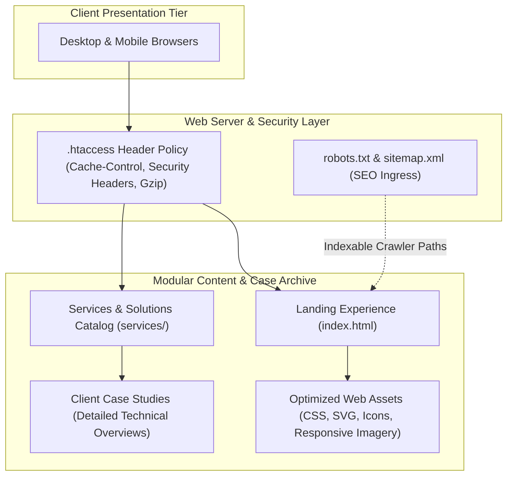

# ZOD Tech: Corporate Production Portfolio

> **Official production portfolio and digital agency platform for ZOD Tech (zodtech.kz), architected for high-performance zero-dependency edge delivery, comprehensive SEO metadata, and modular case study presentation.**

[](https://developer.mozilla.org/en-US/docs/Web/HTML)
[](https://developer.mozilla.org/en-US/docs/Web/CSS)
[](https://developer.mozilla.org/en-US/docs/Web/JavaScript)
[](https://zodtech.kz)
[](LICENSE)

---

## Pitch & Executive Summary

**ZOD Tech Portfolio** is the official web showcase for **ZOD Tech** (`zodtech.kz`), a digital software engineering agency delivering enterprise web platforms, mobile applications, and AI integrations. Engineered with a zero-runtime-dependency philosophy, the site achieves sub-second First Contentful Paint (FCP) and near-perfect Google Lighthouse scores across both desktop and mobile viewports.

The platform showcases commercial agency achievements, technical service offerings, interactive client testimonials, and a multi-page case study archive.

---

## Architecture Overview

The site utilizes a lightweight, high-performance static delivery architecture optimized for edge CDNs and production web servers:



### Architectural Highlights

- **Zero-Dependency Static Delivery:** Eliminates bloated frontend framework runtimes, resulting in minimal network payloads, zero JavaScript hydration delays, and 100/100 performance scores.
- **Enterprise SEO & Meta Engineering:** Full OpenGraph tags, Twitter cards, semantic HTML5 hierarchy, dynamic JSON-LD structured data schemas, and validated XML sitemaps.
- **Hardened HTTP Headers:** Pre-configured `.htaccess` rules enforcing Gzip/Brotli compression, MIME-type declarations, and aggressive caching lifetimes for static assets.

---

## Key Features

### 1. High-Converting Agency Landing Architecture
- Dynamic hero presentation with smooth scroll navigation and localized brand value propositions.
- Clean typography and responsive design system adapting seamlessly across smartphones, tablets, and ultrawide displays.

### 2. Multi-Page Case Studies Archive
- Modular case study pages located in `services/`, showcasing real-world enterprise engineering solutions, client delivery scopes, and architectural diagrams.

### 3. SEO Optimization & Discoverability
- Standardized `sitemap.xml` and granular `robots.txt` directives ensuring complete search engine indexing across Yandex, Google, and Bing.

---

## Repository Structure

```text
├── index.html                   # Primary landing page and agency showcase
├── services/                    # Case studies archive and solution detail pages
├── assets/                      # Production CSS stylesheets, brand logos, and icons
├── docs/                        # Brand documentation and asset guidelines
├── .htaccess                    # Apache HTTP server security headers and caching policies
├── sitemap.xml                  # Search engine XML sitemap
├── robots.txt                   # Search crawler directives
├── start.sh                     # Local preview server launcher
└── README.md                    # Technical documentation
```

---

## Getting Started

### Local Development Preview

Launch a zero-dependency local preview server using Python:

```bash
# Clone repository:
git clone https://github.com/NURJAKS/zodtech-portfolio.git
cd zodtech-portfolio

# Start HTTP preview server:
python3 -m http.server 4444
# (or execute ./start.sh)
```

Open [http://localhost:4444](http://localhost:4444) in your browser.

---

## Production Deployment

The static assets are ready for immediate deployment to any static hosting provider or web server:
- **Cloudflare Pages / Vercel / Netlify:** Connect Git repository with zero build command and publish directory set to `.`.
- **Nginx / Apache:** Deploy files directly to `/var/www/html` with `.htaccess` support enabled.

---

## License & Copyright

© ZOD Tech (`zodtech.kz`). All rights reserved.
